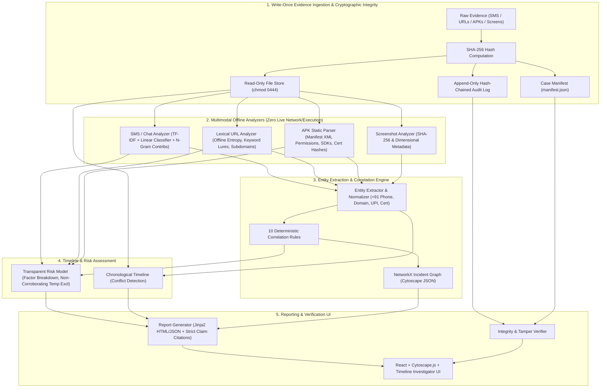

# SCAMTRACE AI: Explainable Multimodal Digital Forensics & Cybercrime Investigation System

> **One-Sentence Pitch**: SCAMTRACE AI is an explainable, multimodal digital forensics workbench that ingests heterogeneous incident evidence (SMS, URLs, APK metadata, chat logs, screenshots), reconstructs cross-artifact correlation graphs, and produces cryptographically verifiable, tamper-evident investigative reports with zero live network probing or dynamic bytecode execution.

---

## Architecture Diagram



---

## Safety and Ethics Notice

> [!CAUTION]
> **STRICT SAFETY CONSTRAINTS (NON-NEGOTIABLE)**
> - **Zero Dynamic Execution**: Android APK files are never executed or emulated. Manifest and certificate inspections are strictly static.
> - **Zero Live Network Calls**: Analyzers make no DNS, WHOIS, or HTTP requests. URL analysis is 100% lexical and offline.
> - **Sanitized Synthetic Data**: Fictional telephone numbers (`+91 99999 XXXXX`), reserved domains (`.test`), and test UPI handles (`@fakebank`) are used throughout. No personal identifiable information is ingested.
> - **Investigative Aid Disclaimer**: SCAMTRACE outputs are decision-support aids for forensic triage, not definitive legal evidence.

See [docs/safety_checklist.md](docs/safety_checklist.md) for full compliance verification.

---

## Key Features

1. **Write-Once Evidence Ingestion & Cryptographic Integrity**
   - SHA-256 calculated on ingest; duplicate rejections enforced.
   - Read-only storage (`chmod 0444`) with write guards.
   - Append-only hash-chained audit log with sequence validation.
   - Case manifest integrity verification.

2. **Multimodal Forensic Analyzers**
   - **Text (SMS/Chat/Email)**: TF-IDF + Logistic Regression / Linear SVM with n-gram explanation weights.
   - **URL**: Purely offline lexical analysis (suspicious TLDs, keyword lures, brand mismatches, token entropy).
   - **APK**: Static metadata extraction (permissions, declared components, SDK targets, certificate fingerprint) without bytecode execution.
   - **Screenshot**: Metadata and cryptographic hashing (tamper-evident container).

3. **Deterministic Correlation Engine (10 Rules)**
   - `SHARED_PHONE`, `SHARED_DOMAIN`, `URL_HOST_MATCH`, `REDIRECT_CHAIN`, `SIMILAR_TEXT_TEMPLATE`, `SAME_BRAND_IMPERSONATION`, `APK_LURE_PATTERN`, `SAME_CERT_HASH`, `SAME_UPI_HANDLE`, `TEMPORAL_PROXIMITY`.
   - Graph queries via NetworkX exported to Cytoscape.js format.
   - Per-rule ablation switches for forensic evaluation.

4. **Chronological Timeline Reconstruction**
   - Timestamp fallback hierarchy (`source_timestamp` -> `uploaded_at`).
   - Undated evidence flagged as `time_uncertain`.
   - Automated causal ordering conflict detection (e.g. APK installation prior to initial lure delivery).

5. **Explainable Risk Scoring Engine**
   - Transparent weighted linear model with additive factor breakdown.
   - Strict exclusion of `TEMPORAL_PROXIMITY` from confirmed infrastructure links.
   - Factor contributions sum exactly to final case score.

6. **Tamper-Evident Report Generation**
   - Jinja2 HTML/JSON reports with strict citation enforcement (`ClaimCitationError` raised if any narrative claim lacks evidence IDs).

---

## Technology Stack

- **Backend**: Python 3.11+, FastAPI, SQLAlchemy 2.x, SQLite, NetworkX, scikit-learn, Jinja2, pytest
- **Frontend**: React, Vite, TypeScript, Cytoscape.js
- **Tooling**: Git, Makefile, PowerShell automation scripts

---

## Quickstart & Setup

### 1. Prerequisites
- Python 3.11+
- Node.js 18+
- Git

### 2. Installation
```bash
# Using Makefile
make install

# On Windows PowerShell
.\make.ps1 install
```

### 3. Running Backend & Frontend
```bash
# Terminal 1: Backend API (http://localhost:8000)
make run-backend
# Or: .\make.ps1 run-backend

# Terminal 2: Frontend Dashboard (http://localhost:5173)
make run-frontend
# Or: .\make.ps1 run-frontend
```

### 4. Running Backend Tests
```bash
make test
# Or: .\make.ps1 test
```

### 5. Reproducing Experiments
```bash
make reproduce-experiments
# Or: .\make.ps1 reproduce-experiments
```
This automatically executes `experiments/generate_synthetic.py` and `experiments/run_all.py`, saving all CSV tables and `results.md` to `experiments/results/`.

---

## Experimental Results & Benchmarks

> [!NOTE]
> All results below were produced by running `experiments/run_all.py` against synthetic benchmarks across 5 fixed seeds (42–46). Data provenance is recorded in `data/data_log.md`.

### 1. Classifier Evaluation on Sealed Test Splits (5 Seeds: 42–46)

| Modality | Baseline Model | Precision (Mean) | Recall (Mean) | F1-Score (Mean) | ROC-AUC (Mean) | FPR (Mean) |
|---|---|---|---|---|---|---|
| **SMS (Text)** | LinearSVM | 1.0000 | 1.0000 | 1.0000 | 1.0000 | 0.0000 |
| **SMS (Text)** | Logistic Regression | 1.0000 | 1.0000 | 1.0000 | 1.0000 | 0.0000 |
| **URL (Lexical)** | Random Forest | 1.0000 | 1.0000 | 1.0000 | 1.0000 | 0.0000 |
| **URL (Lexical)** | Logistic Regression | 1.0000 | 1.0000 | 1.0000 | 1.0000 | 0.0000 |
| **APK (Manifest)** | Random Forest | 1.0000 | 1.0000 | 1.0000 | 1.0000 | 0.0000 |
| **APK (Manifest)** | Logistic Regression | 1.0000 | 1.0000 | 1.0000 | 1.0000 | 0.0000 |

### 2. Correlation Rule Ablation Study

Evaluated against gold-standard multi-artifact scam incident ground truth (`backend/tests/fixtures/example_scenario.json`):

| Rule Disabled | Link Precision | Link Recall | Link F1 |
|---|---|---|---|
| `none (baseline)` | 0.8889 | 0.8889 | 0.8889 |
| `SHARED_PHONE` | 0.8750 | 0.7778 | 0.8235 |
| `SHARED_DOMAIN` | 1.0000 | 0.6667 | 0.8000 |
| `URL_HOST_MATCH` | 0.8750 | 0.7778 | 0.8235 |
| `REDIRECT_CHAIN` | 0.8889 | 0.8889 | 0.8889 |
| `SIMILAR_TEXT_TEMPLATE` | 0.8889 | 0.8889 | 0.8889 |
| `SAME_BRAND_IMPERSONATION` | 0.8333 | 0.5556 | 0.6667 |
| `APK_LURE_PATTERN` | 0.8750 | 0.7778 | 0.8235 |
| `SAME_CERT_HASH` | 0.8889 | 0.8889 | 0.8889 |
| `SAME_UPI_HANDLE` | 0.8889 | 0.8889 | 0.8889 |
| `TEMPORAL_PROXIMITY` | 0.8889 | 0.8889 | 0.8889 |

### 3. Cryptographic Tamper Detection & Audit Log Evaluation

Tested against 5 simulated adversarial attacks on evidence files and audit log records:

| Scenario | Tamper Detected | False Alarms on Untouched Data |
|---|---|---|
| `untouched_baseline` | **NO** | 0 |
| `modify_evidence_byte` | **YES** | 0 |
| `edit_audit_payload` | **YES** | 0 |
| `delete_audit_entry` | **YES** | 0 |
| `swap_audit_entries` | **YES** | 0 |
| `delete_evidence_file` | **YES** | 0 |

### 4. Explanation Faithfulness Evaluation

Evaluated by perturbing the top-attributed feature for each modality and measuring score decrease or class flip:

| Modality | Suspicious Samples | Flipped / Score Decreased | Faithfulness Score | Target (> 0.70) |
|---|---|---|---|---|
| **SMS (Text)** | 24 | 24 | **1.0000** | PASS |
| **URL (Lexical)** | 50 | 50 | **1.0000** | PASS |
| **APK (Manifest)** | 35 | 35 | **1.0000** | PASS |

---

## Known Limitations

1. **Synthetic Evaluation**:
   - All experimental metrics are derived from sanitized synthetic datasets (`data/synthetic/`).
   - Ground truth labels were generated deterministically according to curated scam campaign heuristics.
2. **Offline Lexical URL Scope**:
   - URL analysis relies exclusively on lexical token features, character entropy, keyword patterns, and offline eTLD+1 parsing. It cannot detect dynamic redirect cloaking or compromised legitimate web domains without live traffic analysis (intentionally prohibited for offline safety).
3. **Static Manifest APK Analysis**:
   - APK analysis extracts declared permissions, receivers, and certificate fingerprints. It does not perform dynamic analysis, sandbox execution, or Dalvik bytecode deobfuscation (intentionally prohibited for offline safety).
4. **Screenshot OCR**:
   - In the MVP, screenshots are treated as cryptographic evidence containers (SHA-256 and metadata). Automated OCR and layout analysis are planned for future versions.
5. **Heuristic Risk Calibration**:
   - Case risk scoring represents an empirical triage heuristic designed for explainability, not a calibrated Bayesian posterior probability of legal guilt.

---

## Architecture & Documentation Index

- [docs/architecture.md](docs/architecture.md): System architecture and data flow diagrams.
- [docs/decisions.md](docs/decisions.md): Architecture Decision Records (ADRs).
- [docs/correlation_rules.md](docs/correlation_rules.md): Specification of the 10 correlation rules.
- [docs/safety_checklist.md](docs/safety_checklist.md): Safety compliance and ethics requirements.
- [data/data_log.md](data/data_log.md): Dataset provenance and integrity records.
- [experiments/results/results.md](experiments/results/results.md): Reproducible benchmark tables.
